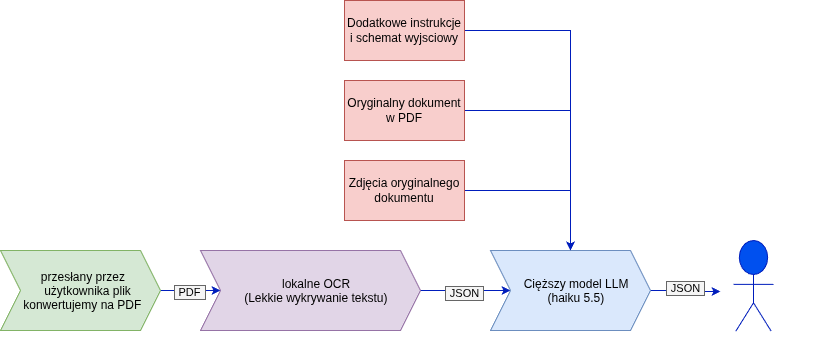

# digiForms - cyfryuzacja formularzy

## Uruchomienie

 Uwaga: Do samodzielnego uruchomienia aplikacji będzie potrzebny klucz API do `EdenAI`.

 - `git clone git@github.com:KacperBronka/DigiForms.git`
 - `cd DigiForms`
 - `echo "EDENAI_API_KEY=TWOJ_KLUCZ_API" > .env` - mozna to zrobic w dowolny inny sposob
 - `docker compose up` (jako admin)

## Stack technologiczny:
 
  - Aplikacja webowa(interfejs uzytkownika): Tanstack Start@1.0 + React
  - Serwer przetwarzajacy pliki: python 3.14
  - docker
  
  Aplikacja wykorzystuje jedynie zależności(bioblioteki) otwartoźródłowe.

## Działanie aplikacji

Przetwarzanie plików opiera się na warstwach. Jest to rozwiązanie wprowadzone przez nas dla usprawnienia procesu i oddelegowania lżejszego zadania do lżejszego rozwiązania. Wizualizacja znajduje się poniżej:

 
Użycie EdenAI jest jedynie rozwiązaniem demonstracyjnym. Podczas implementacji finalnej wersji aplikacji zamierzamy użyć modelu hostowanego lokalnie.
 
## Modele AI

W aplikacji zostały użyte modele:
 - **model OCR** - paddleOCR
 - **anthropic haiku 5.5** jako "ciężki LLM" odpowiedzialny za kontekst, dopasowania typów oraz finalne zwrócenie pliku.
 
## Autorzy:

 - Karol Szelc
 - Kacper Kacper
 - Sebastian Drabik
 - Maciej Michalik
